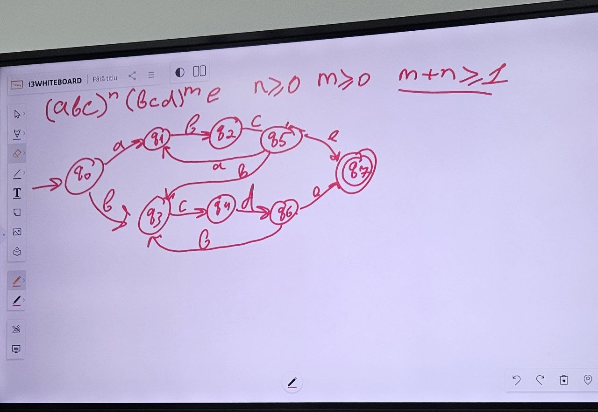

# Regular Expression Validation

## Theory

A **regular expression (regex)** is a sequence of characters that defines a search pattern. Regular expressions can be used to describe regular languages and validate whether an input string follows a specific pattern.

A **finite automaton** is a mathematical model used to recognize regular languages. It consists of a finite number of states and transitions between them. The automaton reads the input string character by character and changes its state according to the defined transitions. If the automaton reaches a final state after reading the entire input, the string is accepted.

Regular expressions and finite automata are equivalent in expressive power: every regular expression can be represented by a finite automaton, and every finite automaton can be described by a regular expression.

## Task

The language used in this work is defined by the following pattern:

$$
(abc)^n(bcd)^me
$$

where:

* `n ≥ 0`
* `m ≥ 0`
* `n + m ≥ 1`

The string consists of zero or more `abc` sequences, followed by zero or more `bcd` sequences, and ends with `e`.

The condition `n + m ≥ 1` means that at least one `abc` or `bcd` sequence must be present.

## Finite Automaton

The following finite automaton was constructed for the given language:



## Regular Expression

The following regular expression is used to validate the input:

```regex id="vsbrkh"
^(?:abc)+(?:bcd)*e$|^(?:abc)*(?:bcd)+e$
```

An equivalent grouped version is:

```regex id="vvsk95"
^(?:(?:abc)+(?:bcd)*|(?:abc)*(?:bcd)+)e$
```

### Regular Expression Explanation

* `^` — beginning of the string.
* `(?:abc)+` — `abc` appears one or more times.
* `(?:abc)*` — `abc` appears zero or more times.
* `(?:bcd)+` — `bcd` appears one or more times.
* `(?:bcd)*` — `bcd` appears zero or more times.
* `|` — alternative (OR).
* `(?:...)` — non-capturing group.
* `e` — required character at the end of the string.
* `$` — end of the string.

The expression contains two alternatives:

```text id="bdkwlz"
(abc)+(bcd)*  -> at least one abc
OR
(abc)*(bcd)+  -> at least one bcd
```

This guarantees that the condition `n + m ≥ 1` is satisfied.

## Test Examples

| Input           | Result  | Explanation                     |
| --------------- | ------- | ------------------------------- |
| `abce`          | Valid   | n = 1, m = 0                    |
| `abcabce`       | Valid   | n = 2, m = 0                    |
| `bcde`          | Valid   | n = 0, m = 1                    |
| `bcdbcde`       | Valid   | n = 0, m = 2                    |
| `abcbcde`       | Valid   | n = 1, m = 1                    |
| `abcabcbcdbcde` | Valid   | n = 2, m = 2                    |
| `e`             | Invalid | n = 0, m = 0                    |
| `abc`           | Invalid | Missing `e`                     |
| `bcdeabc`       | Invalid | `abc` cannot appear after `bcd` |

## Conclusion

In this work, a finite automaton and a regular expression were used to describe the language `(abc)ⁿ(bcd)ᵐe`, where `n ≥ 0`, `m ≥ 0`, and `n + m ≥ 1`.

The regular expression correctly validates whether an input string belongs to the specified language.
