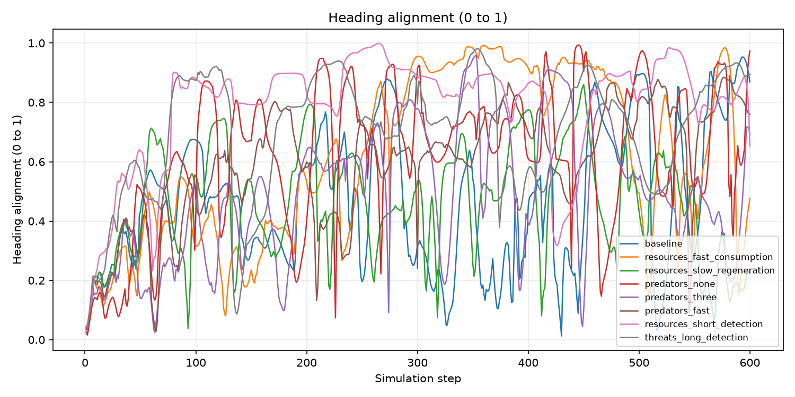
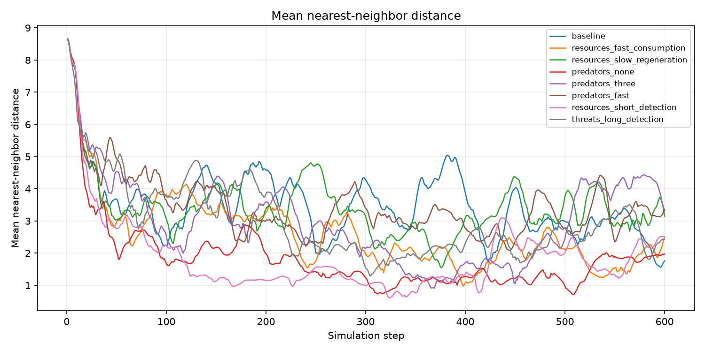
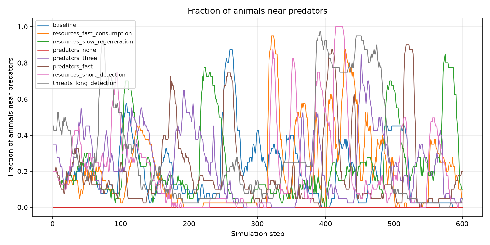
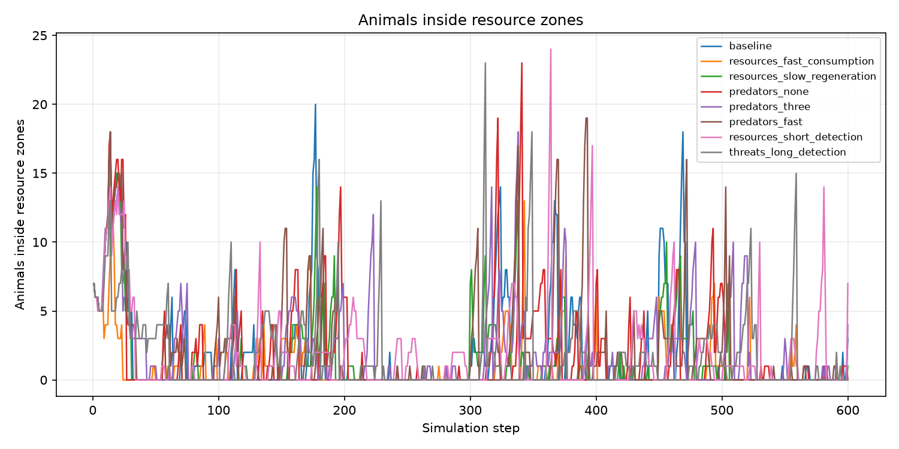
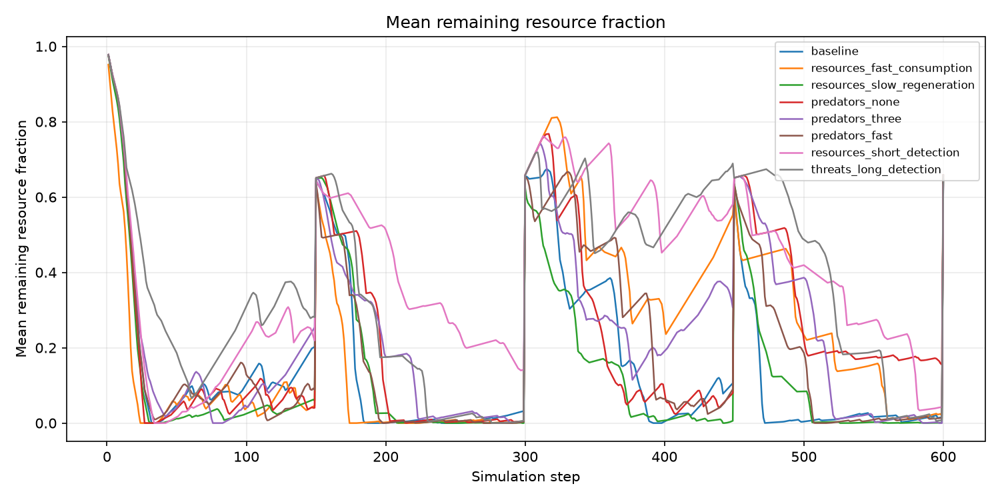

# Отчёт по лабораторной работе

**Тема:** Моделирование коллективного поведения агентов  
**Вариант №5:** Симуляция миграции животных в сезонной среде  
**Выполнил:** Яковлев Владислав  
**Группа:** IA2404  
**Дата выполнения:** 23.10.2026  
**Язык и средства:** Python, NumPy, Matplotlib

## 1. Цель работы

Исследовать адаптивное коллективное поведение животных в двумерной среде с изменяющимися источниками пищи и воды и движущимися хищниками. Реализовать алгоритм Boids с дополнительными правилами поиска ресурсов (*Foraging*) и избегания хищников (*Predator Avoidance*), визуализировать систему и оценить влияние параметров на её поведение.

## 2. Описание модели

Модель представляет собой двумерную периодическую карту размером **100 × 100** условных единиц. Выход за правую границу соответствует появлению у левой границы; аналогично для верхней и нижней границ. При расчёте расстояний также используется кратчайшее расстояние с учётом этой периодичности.

**Состав среды (базовая конфигурация):**

- 40 животных, каждое имеет двумерные координаты и вектор скорости;
- 4 зоны ресурсов: 2 источника пищи и 2 источника воды;
- 2 хищника, преследующих ближайшее обнаруженное животное;
- два чередующихся сезона: влажный и сухой;
- 600 шагов симуляции с фиксированным генератором случайных чисел (`seed=42`).

Начальные положения животных распределены случайно по всей карте, направления начальных скоростей также случайны. Максимальная скорость животных ограничена **1,4**, максимальное управляющее ускорение — **0,12** за шаг.

Зоны ресурсов имеют радиусы 7–9 единиц и исходный запас 100 условных единиц. При смене сезона зоны перемещаются, а запас каждой устанавливается на 65% вместимости. Внутри зоны находящиеся животные расходуют ресурс; параллельно ресурс восстанавливается. Влажный сезон восстанавливает запасы быстрее сухого.

В модели нет размножения, гибели животных, энергетических потребностей, физических тел и фактического поедания добычи. Хищники создают угрозу и изменяют траектории движения.

### 2.1. Базовые параметры

| Параметр | Значение |
|---|---:|
| Размер карты | 100 × 100 |
| Количество животных | 40 |
| Количество хищников | 2 |
| Радиус соседства Boids | 16 |
| Радиус разделения | 5 |
| Вес центрирования | 0,015 |
| Вес выравнивания | 0,08 |
| Вес разделения | 0,18 |
| Вес поиска ресурсов | 0,11 |
| Радиус обнаружения ресурсов | 48 |
| Максимальная скорость животного | 1,4 |
| Максимальное ускорение животного | 0,12 |
| Вес избегания хищника | 0,85 |
| Радиус обнаружения хищника | 19 |
| Радиус преследования хищника | 55 |
| Максимальная скорость хищника | 1,15 |
| Продолжительность сезона | 150 шагов |
| Расход на животное в зоне ресурса | 1,5 за шаг |
| Восстановление во влажный / сухой сезон | 0,8 / 0,1 за шаг |
| Число шагов | 600 |

## 3. Описание алгоритма

Каждое животное использует три базовых правила Boids:

1. **Cohesion (центрирование):** движение в сторону среднего положения локальных соседей. В коде используется средний вектор смещения к соседям, с учётом периодических границ.
2. **Alignment (выравнивание):** согласование скорости со средней скоростью соседей. Из неё вычитается собственная текущая скорость.
3. **Separation (разделение):** отталкивание от слишком близких соседей, причём вклад увеличивается при уменьшении расстояния.

Дополнительные правила:

4. **Foraging (поиск ресурсов):** животное выбирает ближайшую доступную зону, находящуюся в радиусе обнаружения, и получает направляющий вектор к ней. Внутри зоны притяжение к её центру прекращается.
5. **Predator Avoidance (избегание хищников):** при наличии хищников внутри заданного радиуса животное получает вектор ухода от угроз; если угроз несколько, их вклады суммируются. Пока угроза обнаружена, вклад Foraging для данного животного отключается.

Итоговое управляющее ускорение до ограничения записывается как

\[
\mathbf a_i^*=w_c\mathbf C_i+w_a\mathbf A_i+w_s\mathbf S_i+w_f\mathbf F_i\,\mathbb{1}_{\neg danger_i}+w_p\mathbf P_i.
\]

Затем выполняются ограничения ускорения и скорости:

\[
\mathbf a_i=\operatorname{limit}(\mathbf a_i^*,a_{max}),\qquad
\mathbf v_i^{t+1}=\operatorname{limit}(\mathbf v_i^t+\mathbf a_i,v_{max}),
\]

\[
\mathbf x_i^{t+1}=(\mathbf x_i^t+\mathbf v_i^{t+1})\bmod (W,H).
\]

Расчёт ускорений животных выполняется по одному снимку позиций и скоростей, а затем состояния обновляются одновременно. После их перемещения пересчитываются ресурсы и обновляются хищники. Хищник выбирает ближайшее животное в радиусе преследования; в противном случае применяет случайное изменение движения.

Запасы ресурсов обновляются по формуле

\[
R_{t+1}=\operatorname{clip}(R_t+G_{season}-N_{inside}C,0,R_{max}),
\]

где `G` — восстановление в текущем сезоне, `N_inside` — число животных в зоне, `C` — расход на одну особь. При смене сезона ресурсные зоны перемещаются, а запасы переустанавливаются.

## 4. Реализация программы

| Файл | Назначение |
|---|---|
| `config.py` | Все изменяемые параметры модели |
| `animal.py` | Три правила Boids и ограничение длин векторов |
| `resource.py` | Зоны пищи и воды, поиск ресурсов, расход и восстановление |
| `predator.py` | Побег животных и движение хищников |
| `simulation.py` | Создание агентов и последовательность обновлений |
| `visualization.py` | Анимация Matplotlib |
| `metrics.py` | Расчёт количественных показателей |
| `experiments.py` | Пакетные эксперименты, таблицы CSV и графики |
| `main.py` | Запуск интерактивного окна |

Для расчётов применяется **NumPy**, для 2D-анимации и построения графиков — **Matplotlib**. Параметры сосредоточены в `Config`, поэтому эксперименты проводятся без переписывания правил движения.

Запуск в Windows PowerShell:

```powershell
py -m venv .venv
.\.venv\Scripts\python.exe -m pip install -r requirements.txt
.\.venv\Scripts\python.exe main.py
```

Автоматические эксперименты:

```powershell
.\.venv\Scripts\python.exe experiments.py --steps 600 --seed 42 --output results
```

## 5. Результаты визуализации

В окне анимации животные показаны стрелками, отображающими положение и направление движения; при обнаружении угрозы их цвет меняется на красный. Хищники показаны красными маркерами `X`, зоны пищи — зелёными кругами, воды — синими. Подписи ресурсов содержат процент оставшегося запаса. Также отображаются текущий шаг, сезон и число животных, обнаруживших угрозу.

Полученные программой графики за 600 шагов представлены ниже. Они строятся по реальным данным из CSV-файлов, входящих в архив проекта.

**Рисунок 1 — Согласованность направлений движения (Polarization)**



**Рисунок 2 — Среднее расстояние до ближайшего соседа**



**Рисунок 3 — Доля животных около хищников**



**Рисунок 4 — Количество попаданий животных в ресурсные зоны**



**Рисунок 5 — Средняя доля оставшихся ресурсов**



## 6. Эксперименты

Выполнено **8 сценариев по 600 шагов**, каждый с `seed=42`. Исходный сценарий (*baseline*) служит контрольным; в остальных меняется только указанный набор параметров.

### 6.1. Сценарии

| Сценарий | Изменение относительно контрольного |
|---|---|
| `baseline` | Параметры по умолчанию |
| `resources_fast_consumption` | Расход ресурса: 1,5 → 3,0 |
| `resources_slow_regeneration` | Восстановление: 0,8 → 0,2 (влажный); 0,1 → 0,02 (сухой) |
| `predators_none` | Количество хищников: 2 → 0 |
| `predators_three` | Количество хищников: 2 → 3 |
| `predators_fast` | Скорость хищника: 1,15 → 1,8 |
| `resources_short_detection` | Радиус обнаружения ресурсов: 48 → 20 |
| `threats_long_detection` | Радиус обнаружения угроз: 19 → 30 |

### 6.2. Показатели

- **Polarization** — модуль среднего нормированного вектора скорости; значения ближе к 1 означают более согласованные направления движения.
- **Mean nearest distance** — средняя дистанция до ближайшего соседа: приблизительная характеристика локальной плотности стада.
- **Threatened fraction** — доля животных в радиусе хотя бы одного хищника.
- **Animals at resources** — число попаданий животных в доступные ресурсные зоны. Одна особь может учитываться несколько раз, если находится в пересекающихся зонах.
- **Mean resource fraction** — средняя доля оставшегося запаса четырёх ресурсов.

В таблице приведены **средние значения за все 600 шагов** из `results/summary.csv` (значения округлены).

| Сценарий | Polarization | Расстояние до соседа | Доля под угрозой | У ресурсов | Доля запасов |
|---|---:|---:|---:|---:|---:|
| Базовый | 0,470 | 3,488 | 20,47% | 1,710 | 14,81% |
| Быстрый расход | 0,609 | 2,639 | 20,80% | 0,797 | 22,11% |
| Медленное восстановление | 0,460 | 3,401 | 23,46% | 1,332 | 12,23% |
| Без хищников | 0,622 | 1,836 | 0,00% | 1,708 | 21,50% |
| Три хищника | 0,494 | 3,007 | 23,14% | 1,787 | 22,59% |
| Быстрые хищники | 0,594 | 3,440 | 19,41% | 1,787 | 18,26% |
| Малый радиус ресурсов | 0,785 | 1,878 | 22,00% | 1,630 | 39,02% |
| Большой радиус угроз | 0,701 | 3,028 | 29,89% | 1,648 | 35,93% |

### 6.3. Анализ результатов

**Изменение скорости расхода и восстановления.** Удвоение расхода снизило среднее число попаданий в зоны ресурсов с **1,710 до 0,797**. При уменьшении восстановления средний запас сократился с **14,81% до 12,23%**, а число попаданий в ресурсные зоны — до **1,332**. При этом в сценарии быстрого расхода *средний оставшийся запас оказался выше* базового (**22,11%**); это не противоречие в данных, а результат динамики перемещения и занятости зон в конкретном запуске. Запас нельзя интерпретировать как показатель потребления без учёта маршрутов животных.

**Количество и скорость хищников.** Без хищников средняя согласованность выросла с **0,470 до 0,622**, а среднее расстояние до ближайшего соседа сократилось с **3,488 до 1,836**: локально животные держались ближе. При трёх хищниках доля находящихся в радиусе угроз возросла с **20,47% до 23,14%**. При увеличении скорости хищников до **1,8** эта доля, напротив, составила **19,41%**; значит, более высокая скорость не обязательно даёт большее среднее число обнаруженных угроз при конкретной траектории движения.

**Радиусы обнаружения.** Уменьшение радиуса поиска ресурсов с **48 до 20** сопровождалось ростом согласованности движения с **0,470 до 0,785** и увеличением среднего запаса ресурсов с **14,81% до 39,02%**. Увеличение радиуса обнаружения хищников с **19 до 30** повысило долю животных под угрозой с **20,47% до 29,89%**. Здесь показатель зависит и от самой границы определения опасности: с большим радиусом больше животных автоматически считается находящимися под угрозой.

**Интерпретация поведения стада.** На согласованность направлений и локальную плотность влияют не только правила Boids, но и внешние стимулы. Поскольку показатели усреднены по времени, отдельные моменты разделения стада и последующего объединения следует рассматривать на анимации или временных графиках, а не утверждать только по средней величине.

## 7. Выводы

В лабораторной работе реализована модель коллективного движения животных с пятью правилами поведения: Cohesion, Alignment, Separation, Foraging и Predator Avoidance. Добавлены источники пищи и воды с расходом, восстановлением и сезонным перемещением, а также движущиеся хищники. Программа визуализирует изменения в Matplotlib и поддерживает более 500 шагов симуляции.

Результаты восьми вычислительных экспериментов показывают, что изменение доступности ресурсов, числа и скорости хищников и радиусов обнаружения заметно меняет показатели движения и доступности ресурсов. Например, в сценарии без хищников наблюдались более согласованные направления и меньшие расстояния между ближайшими особями; увеличение радиуса угроз повысило зарегистрированную долю животных в опасности.

Выводы относятся к указанной конфигурации и одному случайному зерну. Для статистически устойчивого сравнения желательно провести повторения с несколькими случайными зернами, оценить разброс метрик и дополнительно исследовать траектории отдельных групп. Модель позволяет изучать общие принципы самоорганизации, но не предназначена для точного биологического прогнозирования.
