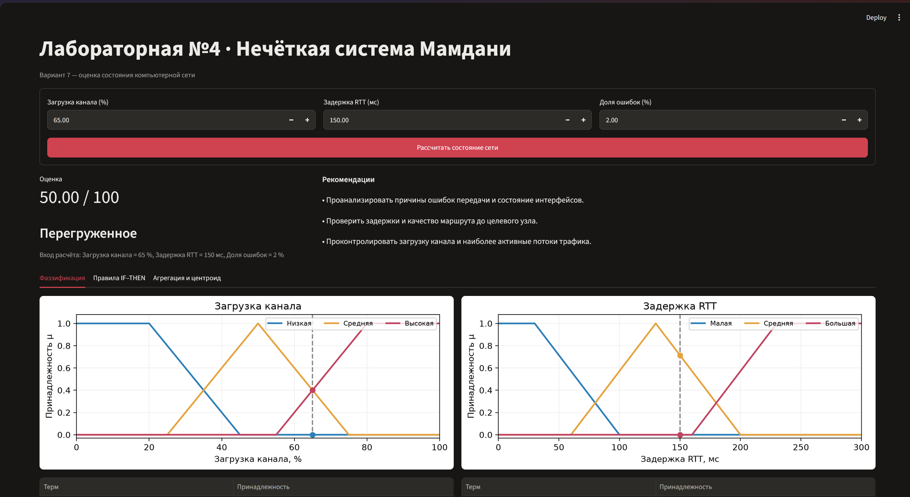
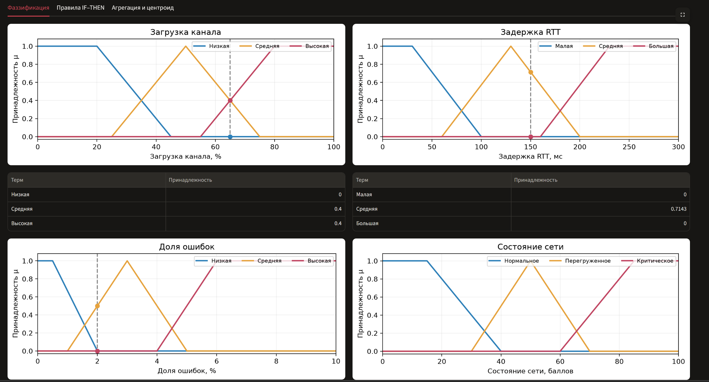

# Лабораторная работа №4 — Нечёткая система Мамдани

**Вариант №7:** Оценка загруженности компьютерной сети  
**Язык:** Python  
**Технологии:** Streamlit, scikit-fuzzy, NumPy, Matplotlib, pandas, pytest  
**Выполнил:** Vladyslav Yakovlev  
**Группа:** IA2404  

## 1. Цель работы

Разработать интерактивную нечёткую систему оценки состояния компьютерной сети по загрузке канала, задержке RTT и доле ошибок передачи. Реализовать этапы нечёткого вывода Мамдани: фаззификацию, вычисление правил IF–THEN с операторами AND/OR, импликацию, агрегацию и дефаззификацию методом центроида. Обеспечить визуализацию функций принадлежности, численный результат, текстовую интерпретацию и рекомендации по устранению проблем.

## 2. Постановка задачи

Система принимает следующие данные:

| Входная переменная | Допустимый диапазон | Лингвистические значения |
|---|---|---|
| Загрузка канала | 0–100 % | низкая, средняя, высокая |
| Задержка RTT | 0–300 мс | малая, средняя, большая |
| Доля ошибок | 0–10 % | низкая, средняя, высокая |

Выходная переменная — **оценка состояния сети** в диапазоне 0–100 баллов: *нормальное*, *перегруженное*, *критическое*. Большие значения соответствуют более серьёзным проблемам.

**Примечание:** диапазоны и параметры функций принадлежности выбраны для учебной модели; они не являются нормативными порогами для любой компьютерной сети.

## 3. Математическая модель

### 3.1. Функции принадлежности

Для входных и выходной переменных используются треугольные (`trimf`) и трапециевидные (`trapmf`) функции из `scikit-fuzzy`.

| Переменная | Низкая / малая / нормальная | Средняя / перегруженная | Высокая / большая / критическая |
|---|---|---|---|
| Загрузка канала | trap(0, 0, 20, 45) | tri(25, 50, 75) | trap(55, 80, 100, 100) |
| RTT | trap(0, 0, 30, 100) | tri(60, 130, 200) | trap(160, 230, 300, 300) |
| Ошибки | trap(0, 0, 0.5, 2) | tri(1, 3, 5) | trap(4, 6, 10, 10) |
| Оценка состояния | trap(0, 0, 15, 40) | tri(30, 50, 70) | trap(60, 85, 100, 100) |

Пересечение нечётких множеств позволяет одному значению одновременно принадлежать нескольким термам с разными степенями принадлежности от 0 до 1.

### 3.2. База правил

Применяются **17 правил**, первые девять соответствуют примерам из задания; остальные расширяют покрытие входных ситуаций.

| № | Условие IF | Вывод THEN |
|---|---|---|
| R1 | Загрузка низкая AND задержка малая | Нормальное |
| R2 | Загрузка высокая AND задержка большая | Перегруженное |
| R3 | Загрузка высокая AND ошибки высокие | Критическое |
| R4 | Загрузка средняя AND задержка средняя | Перегруженное |
| R5 | Ошибки низкие AND задержка малая | Нормальное |
| R6 | Ошибки высокие | Критическое |
| R7 | Загрузка низкая AND задержка большая | Перегруженное |
| R8 | Загрузка средняя AND ошибки высокие | Критическое |
| R9 | Загрузка высокая AND задержка средняя | Перегруженное |
| R10 | Загрузка высокая AND задержка малая | Перегруженное |
| R11 | Загрузка средняя AND задержка малая AND ошибки низкие | Нормальное |
| R12 | Загрузка низкая AND задержка средняя | Нормальное |
| R13 | Загрузка средняя AND задержка большая | Перегруженное |
| R14 | Ошибки средние AND (задержка средняя OR большая) | Перегруженное |
| R15 | Ошибки средние AND задержка малая | Перегруженное |
| R16 | Загрузка высокая AND ошибки средние | Перегруженное |
| R17 | Загрузка низкая AND ошибки средние | Перегруженное |

### 3.3. Этапы вывода Мамдани

**1. Фаззификация.** Для каждого введённого численного значения вычисляются степени принадлежности термам при помощи `fuzz.interp_membership(...)`.

**2. Активация правил.** Для составных условий используются операторы:

- `AND`: $\alpha = \min(\mu_1, \mu_2, \ldots)$;
- `OR`: $\alpha = \max(\mu_1, \mu_2, \ldots)$.

**3. Импликация (обрезка).** Для каждого правила ограничивается высота функции принадлежности соответствующего выходного терма:

$$\mu_i'(y) = \min(\alpha_i,\mu_{output_i}(y)).$$

**4. Агрегация.** Обрезанные функции всех правил объединяются по максимуму:

$$\mu_{agg}(y) = \max_i \mu_i'(y).$$

**5. Дефаззификация.** Итоговая нечёткая функция преобразуется в численную оценку методом центроида:

$$y^*=\frac{\int_0^{100}y\,\mu_{agg}(y)\,dy}{\int_0^{100}\mu_{agg}(y)\,dy}.$$

Для дискретной модели расчёт выполняется средствами `fuzz.defuzz(..., "centroid")`. Если ни одно правило не активировалось и суммарная площадь равна нулю, приложение выдаёт понятную ошибку.

После расчёта применяется следующая текстовая интерпретация: **0–33** — нормальное, **(33, 66]** — перегруженное, **(66, 100]** — критическое. Это правила интерпретации числа после дефаззификации, а не замена нечёткой модели.

## 4. Реализация приложения

| Файл | Назначение |
|---|---|
| `fuzzy_model.py` | Диапазоны, функции принадлежности, описание 17 правил |
| `inference.py` | Проверка данных и этапы алгоритма Мамдани |
| `visualization.py` | Построение графиков функций и результата агрегации |
| `recommendations.py` | Формирование рекомендаций по измеренным параметрам |
| `app.py` | Интерфейс Streamlit, расчёт, вкладки с результатами |
| `tests/test_inference.py` | Автоматические проверки модели |
| `requirements.txt` | Зависимости Python |

Интерфейс реализован в виде веб-приложения Streamlit. Ввод трёх параметров осуществляется через числовые поля. Нажатие кнопки **«Рассчитать состояние сети»** запускает вычисление и выводит оценку, текстовое состояние и рекомендации. Через вкладки можно просмотреть фаззификацию, силы активации всех правил и график «обрезка → агрегация → центроид». Повторный расчёт выполняется без перезапуска приложения.

Входные значения проверяются на принадлежность допустимым диапазонам, числовой тип и конечность значений; предусмотрены сообщения об ошибках для некорректного ввода. Рекомендации формируются по фактическим метрикам и **не влияют** на результат алгоритма Мамдани.

## 5. Результаты работы и скриншоты

### 5.1. Основное окно и пример расчёта



**Рисунок 1 — Интерфейс системы оценки сети.** На скриншоте введены: загрузка **65 %**, RTT **150 мс**, ошибки **2 %**. Получена оценка **50.00 / 100**, интерпретация — **«Перегруженное»**. Приложение предлагает проанализировать ошибки, проверить задержки маршрута и проконтролировать загрузку канала.

### 5.2. Фаззификация входных переменных



**Рисунок 2 — Функции принадлежности и степени принадлежности входных параметров.** Пунктирные вертикальные линии обозначают введённые значения, точки пересечения — вычисленные степени принадлежности. Для загрузки 65 %: низкая — **0**, средняя — **0.4**, высокая — **0.4**. Для RTT 150 мс: малая — **0**, средняя — **0.7143**, большая — **0**. Для ошибок 2 %: низкая — **0**, средняя — **0.5**, высокая — **0**.

Вкладка «Правила IF–THEN» позволяет просмотреть активацию каждого из 17 правил, а вкладка «Агрегация и центроид» показывает обрезанные выходные функции, их объединение и положение итогового центроида.

## 6. Проверка работоспособности

В `tests/test_inference.py` предусмотрены проверки наличия правил R1–R9, расчётов для нормальной/перегруженной/критической сети, работы `OR` через максимум, отклонения некорректных входов и конечности результатов на сетке тестовых значений.

Для запуска проверок:

```powershell
.\.venv\Scripts\python.exe -m pytest -q
```

**Примечание:** приведённые скриншоты подтверждают ручной запуск и пример расчёта. Результат автоматического прогона `pytest` в отчёте не утверждается — тесты необходимо запустить в установленном окружении.

## 7. Инструкция по запуску

### Windows PowerShell

1. Открыть PowerShell в корне проекта, где находится `app.py`.
2. Создать виртуальное окружение:

```powershell
py -m venv .venv
```

3. Установить зависимости:

```powershell
.\.venv\Scripts\python.exe -m pip install -r requirements.txt
```

4. Запустить веб-приложение:

```powershell
.\.venv\Scripts\python.exe -m streamlit run app.py
```

Streamlit выведет локальный адрес (обычно `http://localhost:8501`), по которому можно открыть интерфейс в браузере. Чтобы повторить расчёт, изменить параметры и нажать кнопку. Для остановки сервера нажать `Ctrl+C` в PowerShell.

### Linux / macOS

```bash
python3 -m venv .venv
source .venv/bin/activate
python -m pip install -r requirements.txt
python -m streamlit run app.py
```

## 8. Вывод

Реализована интерактивная нечёткая система оценки состояния компьютерной сети по трём входным параметрам. Используется алгоритм Мамдани с 17 правилами, перекрывающимися функциями принадлежности, операторами `min/max` и дефаззификацией по центроиду. Приложение демонстрирует промежуточные этапы вывода, позволяет повторять расчёт, отображает текстовую оценку состояния сети и выдаёт практические рекомендации. На представленном примере состояние сети классифицировано как перегруженное при итоговой оценке 50.00 баллов.
